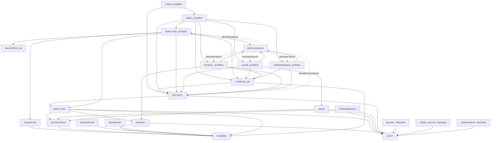

# HRMS discovery inventory

Baseline: `origin/fixture/mc1105-legacy-harness`. This is a source inventory, not a runtime usage survey. No rule IDs are assigned: no `rules.md` exists.

## Counts and migration decision

| Category | Items | In | Out | Source files |
| --- | ---: | ---: | ---: | ---: |
| Forms XML modules | 6 | 6 | 0 | 6 |
| Menu module sources | 1 | 1 | 0 | 1 |
| PLL libraries | 2 | 2 | 0 | 2 |
| PL/SQL packages (spec + body = one item) | 11 | 11 | 0 | 22 |
| Database triggers (individual definitions) | 6 | 6 | 0 | 2 |
| Supporting schema scripts | 6 | 6 | 0 | 6 |
| Supporting seed scripts | 2 | 2 | 0 | 2 |
| **Total** | **34** | **34** | **0** | **41** |

There are **26 executable/module items**, plus **8 supporting items**. Directory enumeration found eleven packages, including PKG_VALIDATION. No database triggers are defined inside `schema/`; XML event triggers remain part of their owning screen, not separate database-trigger items.

All discovered items stay in scope. Lack of a checked-in caller or golden coverage is not proof of dead code. Migration means preserving or deliberately replacing behavior, not retaining Oracle deployment artifacts. Target: **Java 17 + Spring Boot 3 + Maven + Flyway PostgreSQL**. Each of the six migrated Forms screens becomes a REST API surface (including login/session and menu/authorization capabilities); PLL and menu behavior is consolidated rather than compiled as Forms artifacts.

**PAYROLL owner decision:** tax and wage-cap logic becomes business-maintained, effective-dated rate tables, not a 1:1 port of constants/branch logic. Retain payroll calculation scope, characterize existing results, then test dated-rate boundaries and approved differences. Golden coverage will be extended to other packages and screen/API flows; current absence of coverage is a gap, not a retirement decision.

## Evidence and coverage semantics

Callers/callees below come from actual qualified call sites, XML attachments/menu references, DML, and trigger declarations. Self-calls are excluded from inter-package edges. `None found` means no executable checked-in caller, not proven unused in production. Tables/built-ins are summarized rather than treated as extra migration items. Package names in comments are not executable edges.

`harness/run_golden.sh` starts Oracle, generates/loads SQL with `harness/load.py`, executes `harness/calculate.sql`, and diffs only `payroll.csv` and `leave.csv`. It does not start Forms. `calculate.sql` directly invokes only:

* `PKG_PAYROLL.create_pay_periods(2024, 'MONTHLY', 'FIXTURE')`, `create_payroll_run`, `calculate_payroll` (which calls internal `calculate_employee_pay`).
* `PKG_LEAVE.run_monthly_accrual(date '2024-01-31', 'FIXTURE')` (internal balance lookup/initialization).

It checks employee error count and active-employee completeness. CSVs assert payroll detail amounts/status and leave opening/accrued/used/adjustment values, **not** audit events, authentication, approvals, notifications, or UI behavior. COMMON is reachable only on payroll error handling, which the successful fixture rejects; AUDIT is not called by these selected payroll/leave entry paths. Package-wide dependencies must not be mistaken for executed coverage.

`load.py` loads, in this order: all schema tables, sequences, seeds, all package specs, all package bodies, views, then trigger files. Thus seed insertion happens **before triggers exist**. Five triggers are loaded but none is fired by the selected calculation DML (payroll runs/details and leave balances/accrual log are not their target events). `TRG_EMP_BEFORE_UPDATE` alone is removed by name from `trg_employees.sql`: it references `HISTORY_ID`, `CHANGE_DATE`, `OLD_VALUE`, `NEW_VALUE`, `CHANGED_BY`, `CHANGE_REASON`, whereas `schema/tables/01_core_tables.sql:152` defines `HIST_ID`, `EFFECTIVE_DATE`, typed old/new columns, etc. Omission is not evidence its rules can be dropped.

The loader attempts **all eleven packages**, compiles the schema, prints `all_errors`, and fails if any errors have **`name != 'PKG_SECURITY'`** (SECURITY alone is exempt). Its explicit diagnostic says `PKG_SECURITY requires DBMS_CRYPTO unavailable in this slim fixture; payroll and leave do not call it.` SECURITY body uses DBMS_CRYPTO at lines 19–21 and 184–201; its compile errors are tolerated, not fixed or a successful authentication test. This conclusion is based on loader/source evidence; no Oracle run or live error transcript was collected for this documentation change.

The fixture also rewrites seed aliases (`PHONE`, `GRADE_LEVEL`, `DESCRIPTION`) and SQLERRM-in-SQL usages in PAYROLL/NOTIFICATION in generated SQL. It freezes Oracle time to 2024-01-31. These are harness adaptations, not fixes to source or evidence of complete parity.

Coverage keys: **G** = selected behavior directly asserted by CSV; **L** = loaded only, **NO golden coverage**; **N** = not loaded/executed, **NO golden coverage**; **E** = SECURITY attempted but compile errors tolerated, **NO golden coverage**; **O** = explicitly omitted, **NO golden coverage**. Supporting fixture inputs are marked separately; loading is never equated with behavioral coverage.

## Inventory tables

Order numbers refer to the dependency-first waves below. Every row is in scope; reasons describe what is retained/replaced. Paths are repository-relative.

### Forms and menu

| Name | Source file | Callers | Callees / dependencies | Golden | Scope / reason | Port order |
| --- | --- | --- | --- | --- | --- | --- |
| HRMS_LOGIN | `forms/xml-exports/HRMS_LOGIN.xml` | External Forms entry; no OPEN_FORM caller found | PKG_SECURITY.authenticate; OPEN_FORM HRMS_MENU | N | In — authentication/session REST API | 7 |
| HRMS_MENU (screen) | `forms/xml-exports/HRMS_MENU.xml` | HRMS_LOGIN | PKG_SECURITY permissions/logout; COMMON_LIB attachment; OPEN_FORM EMPLOYEE, PAYROLL, LEAVE, PERFORMANCE, REPORTS, ADMIN | N | In — authorized navigation/session REST API | 6 |
| HRMS_EMPLOYEE | `forms/xml-exports/HRMS_EMPLOYEE.xml` | MENU screen; menu source describes launch | PKG_SECURITY session/permission; PKG_EMPLOYEE.generate_emp_number; PKG_VALIDATION.validate_email_format; COMMON_LIB and VALIDATION_LIB attached; HRMS_MENU menu; direct employee/reference SQL | N | In — employee REST API, including direct Forms DML behavior | 6 |
| HRMS_LEAVE | `forms/xml-exports/HRMS_LEAVE.xml` | MENU screen; menu source describes launch | PKG_SECURITY.is_session_valid; PKG_LEAVE submit/cancel; COMMON_LIB attached; HRMS_MENU menu; leave SQL | N | In — leave REST API | 6 |
| HRMS_PAYROLL | `forms/xml-exports/HRMS_PAYROLL.xml` | MENU screen; menu source describes launch | PKG_SECURITY session/permission; PKG_PAYROLL create/calculate/approve; COMMON_LIB attached; HRMS_MENU menu; payroll SQL | N | In — payroll REST API, dated rates decision applies | 6 |
| HRMS_PERFORMANCE | `forms/xml-exports/HRMS_PERFORMANCE.xml` | MENU screen; menu source describes launch | PKG_SECURITY.is_session_valid; COMMON_LIB attached; HRMS_MENU menu; direct review/goal/employee SQL; no PKG_PERFORMANCE call | N | In — performance REST API, including direct table workflows | 6 |
| HRMS_MENU (menu source) | `forms/menus/HRMS_MENU.mmb.sql` | MenuModule attributes in EMPLOYEE, LEAVE, PAYROLL, PERFORMANCE | Comment-only representation of Forms built-ins, SECURITY permissions and child OPEN_FORM targets; no executable SQL body | N | In — menu/authorization behavior is retained, not binary format | 6 |

LOGIN has no AttachedLibrary declaration, despite COMMON_LIB's header claiming all forms attach it. The other five do. All six screens directly call SECURITY. Menu source is entirely comments: distinguish its described dependencies from executable XML menu actions. REPORTS and ADMIN are referenced but their screen exports do **not** exist here; do not fabricate inventory rows or APIs from absent source. Resolve missing implementations during discovery.

### PLL libraries

| Name | Source file | Callers | Callees / dependencies | Golden | Scope / reason | Port order |
| --- | --- | --- | --- | --- | --- | --- |
| HRMS_COMMON_LIB | `forms/libraries/HRMS_COMMON_LIB.pll.sql` | Attached by MENU, EMPLOYEE, LEAVE, PAYROLL, PERFORMANCE; attachment is not proof every helper runs | PKG_COMMON.log_error; PKG_SECURITY.is_session_valid; Forms toolbar/session/LOV built-ins | N | In — consolidate error/session/navigation behavior into API services | 5 |
| HRMS_VALIDATION_LIB | `forms/libraries/HRMS_VALIDATION_LIB.pll.sql` | EMPLOYEE attachment; no explicit helper invocation found | No package calls; JOB_GRADES query; local validation/Forms semantics | N | In — reconcile client/server validation, attachment alone does not justify retirement | 1 |

### PL/SQL packages

| Name | Source file | Callers | Callees / dependencies | Golden | Scope / reason | Port order |
| --- | --- | --- | --- | --- | --- | --- |
| PKG_COMMON | `plsql/packages/PKG_COMMON.pks`, `plsql/packages/PKG_COMMON.pkb` | VALIDATION, EMPLOYEE, PAYROLL, NOTIFICATION, INTEGRATION, REPORTING; COMMON_LIB | No other package; logging/parameters/reference SQL, DBMS_OUTPUT | L; payroll error path only conditional | In — shared utilities and reference behavior | 1 |
| PKG_AUDIT | `plsql/packages/PKG_AUDIT.pks`, `plsql/packages/PKG_AUDIT.pkb` | EMPLOYEE, PAYROLL, LEAVE, PERFORMANCE, SECURITY; SALARY/LEAVE_REQUEST/DEPARTMENT audit triggers | No other package; AUDIT_LOG, SYS_CONTEXT, DBMS_OUTPUT | L | In — audit/compliance semantics | 1 |
| PKG_VALIDATION | `plsql/packages/PKG_VALIDATION.pks`, `plsql/packages/PKG_VALIDATION.pkb` | EMPLOYEE screen validate_email_format | PKG_COMMON.is_valid_email/is_valid_phone; reference SQL | L | In — canonical server-side validation | 2 |
| PKG_NOTIFICATION | `plsql/packages/PKG_NOTIFICATION.pks`, `plsql/packages/PKG_NOTIFICATION.pkb` | EMPLOYEE, LEAVE, PERFORMANCE | PKG_COMMON log_error/log_info; notification queue SQL | L | In — notification queue and delivery workflow | 2 |
| PKG_PAYROLL | `plsql/packages/PKG_PAYROLL.pks`, `plsql/packages/PKG_PAYROLL.pkb` | EMPLOYEE create_salary_record; PAYROLL screen; harness/calculate.sql | PKG_AUDIT.log_action; PKG_COMMON.log_error; salary DML fires TRG_SALARY_AUDIT outside selected golden path | G — periods/run/calculation only; not approval, salary mutation, reports or all tax boundaries | In — payroll retained; tax/wage caps replaced with dated business-maintained rates | 2 |
| PKG_INTEGRATION | `plsql/packages/PKG_INTEGRATION.pks`, `plsql/packages/PKG_INTEGRATION.pkb` | None found in checked-in executable source | PKG_COMMON logging/get_param; GL/benefits/attendance/org SQL | L | In — external/batch entry points possible; no caller is not proof of dead code | 2 |
| PKG_REPORTING | `plsql/packages/PKG_REPORTING.pks`, `plsql/packages/PKG_REPORTING.pkb` | None found in checked-in executable source | PKG_COMMON.log_info; reporting SQL | L | In — reporting contract retained pending external-caller discovery | 2 |
| PKG_EMPLOYEE | `plsql/packages/PKG_EMPLOYEE.pks`, `plsql/packages/PKG_EMPLOYEE.pkb` | EMPLOYEE screen generate_emp_number; SECURITY.set_session_context | PKG_PAYROLL.create_salary_record; PKG_AUDIT.log_action; PKG_COMMON.log_error; PKG_NOTIFICATION.send_notification; employee DML triggers | L | In — employee lifecycle and context behavior | 3 |
| PKG_LEAVE | `plsql/packages/PKG_LEAVE.pks`, `plsql/packages/PKG_LEAVE.pkb` | LEAVE screen; harness/calculate.sql | PKG_NOTIFICATION.send_notification; PKG_AUDIT.log_action; leave status DML fires TRG_LEAVE_REQUEST_AUDIT outside golden accrual | G — monthly accrual/balances only; not submit/approve/reject/cancel | In — leave workflow and accrual | 3 |
| PKG_PERFORMANCE | `plsql/packages/PKG_PERFORMANCE.pks`, `plsql/packages/PKG_PERFORMANCE.pkb` | None found; PERFORMANCE screen uses tables directly | PKG_AUDIT.log_action; PKG_NOTIFICATION.send_notification; review SQL | L | In — review workflow remains, absent screen call is not retirement evidence | 3 |
| PKG_SECURITY | `plsql/packages/PKG_SECURITY.pks`, `plsql/packages/PKG_SECURITY.pkb` | All six screens; COMMON_LIB | PKG_EMPLOYEE.set_session_context; PKG_AUDIT.log_action; DBMS_CRYPTO/UTL_RAW; credentials/session SQL | E | In — authentication/authorization must replace legacy crypto/session design | 4 |

### Database triggers

Each trigger is listed separately, including three definitions per trigger file. Callers here mean the actual DML event, not an explicit procedure invocation. Examples identify executable writers, not exhaustive production writer lists.

| Name | Source file | Callers / firing event | Callees / dependencies | Golden | Scope / reason | Port order |
| --- | --- | --- | --- | --- | --- | --- |
| TRG_EMP_BEFORE_INSERT | `plsql/triggers/trg_employees.sql` | BEFORE INSERT EMPLOYEES; PKG_EMPLOYEE hire, EMPLOYEE Forms DML; seed inserts occur before installation | No package; defaults, date/email checks, EMPLOYEES query | L | In — defaults/validation must be characterized, including row-trigger hazards | 1 |
| TRG_EMP_BEFORE_UPDATE | `plsql/triggers/trg_employees.sql` | BEFORE UPDATE EMPLOYEES; PKG_EMPLOYEE lifecycle methods and Forms DML | No package; EMPLOYEE_HISTORY insert, SEQ_EMP_HISTORY; incompatible columns | O | In — reconcile history/state-transition rules; harness omission is not retirement | 1 |
| TRG_EMP_INSTEAD_OF_DELETE | `plsql/triggers/trg_employees.sql` | Actually BEFORE DELETE EMPLOYEES, not an INSTEAD OF trigger; direct delete attempts | No package; raises -20504, does not perform soft delete | L | In — retain explicit deletion policy, reconcile Forms expectations | 1 |
| TRG_SALARY_AUDIT | `plsql/triggers/trg_audit.sql` | AFTER INSERT/UPDATE/DELETE SALARY_RECORDS; PKG_PAYROLL.create_salary_record; seeds precede installation | PKG_AUDIT.log_action | L | In — salary audit events | 2 |
| TRG_LEAVE_REQUEST_AUDIT | `plsql/triggers/trg_audit.sql` | AFTER UPDATE OF STATUS LEAVE_REQUESTS; PKG_LEAVE approve/reject/cancel | PKG_AUDIT.log_action | L | In — leave status audit events | 2 |
| TRG_DEPARTMENT_AUDIT | `plsql/triggers/trg_audit.sql` | AFTER INSERT/UPDATE/DELETE DEPARTMENTS; direct DML; seed inserts precede installation; no later fixture writer | PKG_AUDIT.log_action | L | In — organization-change audit events | 2 |

### Supporting schema and seed items

These are file-level supporting items (not one item per table/sequence/view). No qualified package calls or database-trigger definitions were found in these files. Dependencies are DDL/FK/SQL dependencies, not procedure edges. Port core tables before dependent payroll/leave/performance tables; sequences before inserts; views after base tables; fixture data after schema, respecting FK order.

| Name | Source file | Callers / consumers | Callees / dependencies | Golden | Scope / reason | Port order |
| --- | --- | --- | --- | --- | --- | --- |
| Core tables | `schema/tables/01_core_tables.sql` | load.py; employee/security/reference consumers | Core FK relationships, including employee self-reference | Fixture input, not full DDL behavior coverage | In — Flyway PostgreSQL core model | 0a |
| Payroll tables | `schema/tables/02_payroll_tables.sql` | load.py; PAYROLL/EMPLOYEE/INTEGRATION/REPORTING | Core employee/reference FKs | Fixture input; payroll subset asserted | In — payroll model plus dated rate tables | 0b |
| Leave tables | `schema/tables/03_leave_tables.sql` | load.py; LEAVE, Forms/reporting consumers | Core employee FKs | Fixture input; balance subset asserted | In — leave model | 0b |
| Performance and system tables | `schema/tables/04_performance_tables.sql` | load.py; PERFORMANCE, SECURITY, COMMON, AUDIT, NOTIFICATION | Core employee FKs; review relationships | Fixture input; NO direct golden coverage of review/security/audit behavior | In — review and cross-cutting persistence | 0b |
| Sequences | `schema/sequences/hrms_sequences.sql` | load.py; package and seed NEXTVAL consumers | No package calls; identity allocation | Fixture input; not all sequences used | In — replace Oracle allocation with PostgreSQL sequences/identities | 0a |
| Views | `schema/views/hrms_views.sql` | load.py; SQL/report consumers; not selected by calculate.sql | Base-table joins; active employees/org/compensation/leave/payroll/approvals | L | In — preserve query contracts | 0c |
| Reference seed | `data/seed/01_reference_data.sql` | load.py; reference/parameter consumers | Inserts core/reference/payroll/leave data; sequence/table dependencies | Fixture input, loader alias rewrites apply | In — migrate required reference/config data, validate aliases | 0d |
| Employee seed | `data/seed/02_employee_data.sql` | load.py; payroll/leave active-employee selection | Employee/salary/deduction data and sequences; reference FKs | Fixture input; subset of derived values asserted | In — characterization fixtures, not automatic production data load | 0d |

## Dependency graph and proposed port order

Arrows mean caller → dependency; port the arrow target first. The package graph has **no executable inter-package cycle**. EMPLOYEE.pkb:273–274 claims a circular EMPLOYEE → PAYROLL → EMPLOYEE dependency, but PAYROLL's implementation has no PKG_EMPLOYEE call (its create_salary_record validates salary directly). Likewise `calculate_final_pay` is only an EMPLOYEE TODO, not a call. Do not elevate either comment to an edge.



Package labels abbreviate PKG_; screen labels abbreviate HRMS_. The three employee triggers and VALIDATION_LIB have no outgoing package edges. Persistence dependencies are in the supporting table, not repeated on every graph node. DML edges to audit triggers add no cycle: PAYROLL → SALARY_TRIGGER → AUDIT and LEAVE → LEAVE_STATUS_TRIGGER → AUDIT; EMPLOYEE DML reaches employee triggers, which call no package.

The **navigation/attachment cycle** is distinct: child screens attach HRMS_MENU menu module, whose comment-only source describes opening those screens. Treat the four child screens and menu source as one integration component (wave 6), rather than pretending a strict order exists for the described navigation graph. The executable package graph is acyclic. MENU screen's embedded XML menu has actual OPEN_FORM calls; it is not the same source as the `.mmb.sql` menu representation. No recursive package dependency was found through trigger bodies either.

Dependency-first waves (independent items in a wave may be parallelized):

0. **Persistence:** 0a core tables + sequences; 0b payroll/leave/performance-system tables; 0c views; 0d reference then employee fixtures. Resolve core FK/self-reference ordering in Flyway.
1. **Leaves:** COMMON, AUDIT, VALIDATION_LIB behavior, all three employee-trigger behaviors (resolve update/history mismatch before porting).
2. **Foundation consumers:** VALIDATION, NOTIFICATION, PAYROLL, INTEGRATION, REPORTING; three audit-trigger behaviors (AUDIT first). PAYROLL's salary-write behavior follows salary audit behavior within this wave. Introduce dated rates with the PAYROLL owner.
3. **Domain orchestration:** EMPLOYEE, LEAVE, PERFORMANCE; LEAVE status writes follow leave-audit behavior.
4. **Security:** SECURITY after EMPLOYEE context and AUDIT; replace crypto safely, not by reproducing hard-coded-key design.
5. **Shared Forms behavior:** COMMON_LIB after COMMON/SECURITY, folded into services.
6. **Screen/navigation component:** EMPLOYEE, LEAVE, PAYROLL, PERFORMANCE APIs; MENU API and menu source behavior. Break navigation coupling into API contracts and integrate the component together.
7. **Login API:** after SECURITY and MENU navigation contract; endpoint internals can be developed earlier against those contracts.

This is behavior/dependency order, not Oracle compilation order (specs permit cross-references). Build new golden/characterization tests before each uncovered wave, covering normal, empty and error cases, audit side effects, authorization failures, state transitions, and dated tax/rate boundaries. Current CSVs do not establish those contracts.

## Reproducible method

Run from repository root. Enumerate actual contents before interpreting names:

```sh
find forms/xml-exports forms/menus forms/libraries plsql/packages plsql/triggers schema data/seed -type f | sort
rg -n -i 'create\s+or\s+replace\s+trigger|create\s+trigger' plsql/triggers schema
rg -n -i 'PKG_[A-Z_]+\.' forms plsql schema data/seed harness
rg -n 'AttachedLibrary|MenuModule|OPEN_FORM|QueryDataSourceName|CommandText' forms
rg -n -i 'insert into|update |delete from|references|nextval' plsql schema data/seed
rg -n -i 'PKG_EMPLOYEE\.|PKG_PAYROLL\.|circular|calculate_final_pay' plsql/packages
rg -n 'glob|group|TRG_EMP_BEFORE_UPDATE|SQLERRM|PKG_SECURITY|all_errors|fixed_date' harness/load.py
rg -n 'PKG_|spool|select|error' harness/calculate.sql
rg -n 'load.py|calculate.sql|diff|for file' harness/run_golden.sh
```

Read the surrounding procedure bodies, trigger event clauses, and loader ordering after grep: comments/attachments/package existence alone do not prove execution. No production caller logs, external schedulers or runtime Forms binaries were available; no live harness execution was required for this source discovery.

Completeness check (checks table source cells, not incidental prose; validates each individual database trigger too):

```sh
python3 - <<'PY'
from pathlib import Path
import re
roots = ['forms/xml-exports', 'forms/menus', 'forms/libraries',
         'plsql/packages', 'plsql/triggers', 'schema', 'data/seed']
doc = Path('docs/modernization/inventory.md').read_text()
rows = [line.split('|') for line in doc.splitlines() if line.startswith('|')]
listed = {p for row in rows if len(row) > 3
          for p in re.findall(r'`([^`]+)`', row[2])}
files = {str(p) for root in roots for p in Path(root).rglob('*') if p.is_file()}
missing = sorted(files - listed)
extra = sorted(listed - files)
triggers = {m.upper() for root in ['plsql/triggers', 'schema']
            for p in Path(root).rglob('*') if p.is_file()
            for m in re.findall(r'CREATE\s+(?:OR\s+REPLACE\s+)?TRIGGER\s+(?:HRMS\.)?(\w+)', p.read_text(), re.I)}
names = {row[1].strip().upper() for row in rows if len(row) > 3}
missing_triggers = sorted(triggers - names)
print(f'Source files: {len(files)}; inventoried: {len(listed)}')
print(f'Missing files ({len(missing)}): {missing}')
print(f'Unexpected files ({len(extra)}): {extra}')
print(f'Database triggers: {len(triggers)}')
print(f'Missing trigger items ({len(missing_triggers)}): {missing_triggers}')
assert not missing and not extra and not missing_triggers
PY
```
